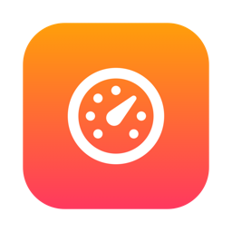
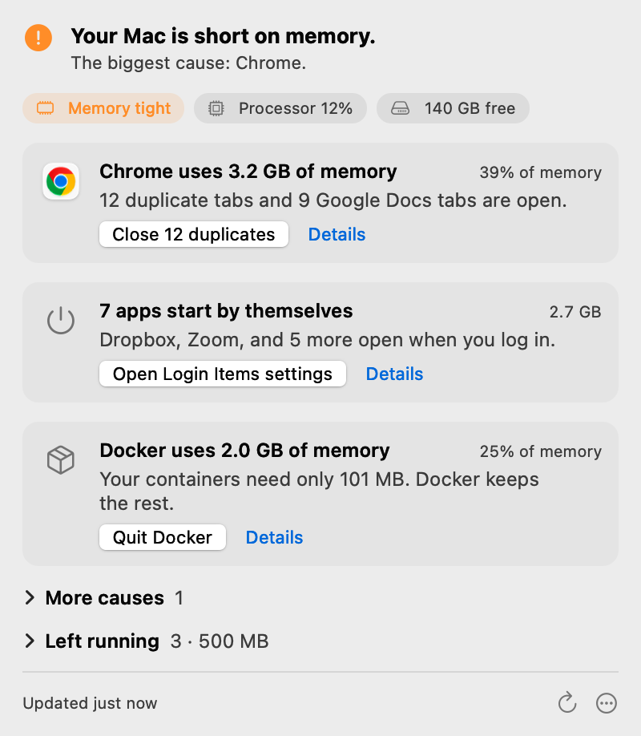
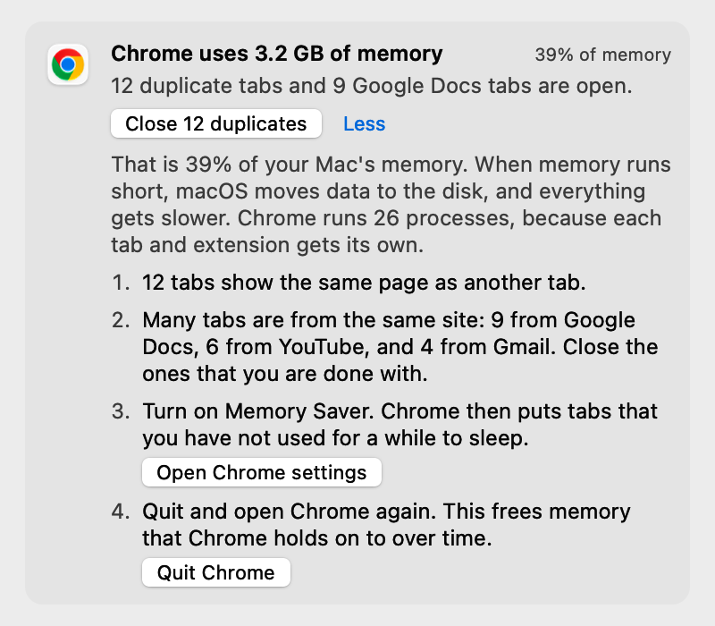
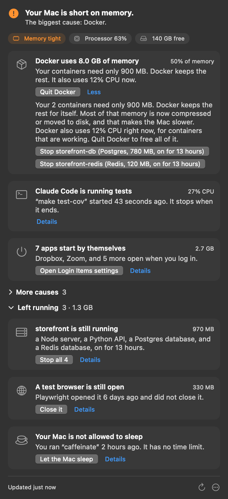

<p align="center"></p>

<h1 align="center">Sluggish</h1>

<p align="center">A macOS menu bar app that tells you why your Mac is slow.<br>
One line names the cause. One button gives you a safe fix.</p>

<p align="center"><a href="https://sluggishapp.com">sluggishapp.com</a> · <a href="https://sluggishapp.com/download/Sluggish.zip">Download the free trial</a> · $12, one time</p>

<p align="center"><picture>
<source srcset="site/shots/hero-dark.png" media="(prefers-color-scheme: dark)">

</picture></p>

## How it works

1. Click the gauge in the menu bar. Sluggish does nothing until you click it.
2. Read the top line. It names the main cause, for example "Your Mac is short on memory. The biggest cause: Chrome."
3. Click one button. The button quits an app, closes duplicate tabs, or opens the correct page of System Settings.

Sluggish has no dashboard, no charts and no history. You get the answer and one thing to do.

## What it finds

| Cause | What Sluggish does |
| --- | --- |
| The Mac is too hot | It tells you why macOS slows the processor, and what to do. |
| A browser uses too much memory | It counts duplicate tabs and piles of tabs from one site. It can close the duplicates. |
| The disk is almost full | It opens Storage settings. |
| Too many apps start at login | It names them, shows their memory, and opens Login Items. |
| Photos, iCloud or Spotlight is busy | It tells you that this is normal and that it stops by itself. |

Each card says what is wrong, why, and one fix.

<p align="center"><picture>
<source srcset="site/shots/details-dark.png" media="(prefers-color-scheme: dark)">

</picture></p>

## For developers

Sluggish shows a developer card only when the cause exists. It finds:

- The Docker VM, and how much memory the containers really use.
- Dev servers that ran for days, grouped by git repo and branch, with the pull request title.
- Test browsers that Playwright did not close, and booted Xcode simulators.
- `caffeinate` with no time limit.
- Processes that Claude Code started, and the session that started them.

If Sluggish does not know a process, Apple's on-device model writes one line about it on macOS 26. The panel marks the line as a guess.

<p align="center"></p>

## What it never does

- It never deletes files.
- It never runs in the background. When the panel is closed, it checks nothing.
- It never quits an app unless you click. Quit sends Cmd-Q, so the app can save your work.
- It makes no network connections of its own. It has no telemetry, no analytics, no account and no update check. One developer setting is off until you turn it on. It asks the GitHub CLI for pull request titles, with your own login.
- It asks for the Automation permission only when you click "See my open tabs".

## How it is built

Sluggish is about 2,200 lines of Swift and one small Cloudflare Worker. It has no third-party dependencies.

| File | What it does |
| --- | --- |
| [`Sources/Sluggish/Probe.swift`](Sources/Sluggish/Probe.swift) | Reads processes, memory, heat, disk and containers into one `Snapshot`. |
| [`Sources/Sluggish/Detect.swift`](Sources/Sluggish/Detect.swift) | Fixed rules that change a `Snapshot` into findings: the cause, the reason and the fix. |
| [`Sources/Sluggish/AppKitPanel.swift`](Sources/Sluggish/AppKitPanel.swift) | The menu bar panel. |
| [`Sources/Sluggish/Context.swift`](Sources/Sluggish/Context.swift) | The git repo, branch and pull request title of a dev server. |
| [`Sources/Sluggish/Tabs.swift`](Sources/Sluggish/Tabs.swift) | Reads and closes browser tabs with AppleScript. |
| [`Sources/Sluggish/AI.swift`](Sources/Sluggish/AI.swift) | The one-line guess from Apple's on-device model. |
| [`Sources/Sluggish/License.swift`](Sources/Sluggish/License.swift) | The free trial and the offline license check. |
| [`server/`](server/) | A Cloudflare Worker that changes a Paddle purchase into a license key. |
| [`site/`](site/) | The website at sluggishapp.com. |

A tool for a slow Mac must not make the Mac slower. These decisions keep the app small:

- The panel uses AppKit, not SwiftUI. An empty SwiftUI menu bar app needs 16 MB. An empty AppKit app needs 12 MB.
- Tab reads run in `/usr/bin/osascript`, not in the app. The AppleScript engine costs about 15 MB for the life of the app.
- A check reads the path and the arguments of a process only one time for each process.
- The app links FoundationModels weakly. The same binary starts on macOS 14 and 15, without the AI line.
- A license key is a payload with an Ed25519 signature. The app checks the signature on the Mac with the public key. The private key is not in this repo.

## Build and run

You need Xcode 26 or later, because the build needs the macOS 26 SDK. The app runs on macOS 14 or later, on Apple silicon and Intel.

```sh
swift build -c release
./bundle.sh
open build/Sluggish.app
```

`bundle.sh` makes `build/Sluggish.app` with an ad-hoc signature. Set `SIGN_ID` to a Developer ID identity to sign and notarize the app.

The binary also has commands for the terminal:

| Command | What it does |
| --- | --- |
| `.build/release/Sluggish --print` | Prints the report for this Mac as text. |
| `.build/release/Sluggish --demo --scenario developer` | Prints the report for a fixed demo Mac. The scenarios are `memory`, `calm` and `developer`. |
| `.build/release/Sluggish --snapshot out.png --scenario developer --dark --open` | Draws the panel into a PNG. The screenshots in this README come from this command. |
| `.build/release/Sluggish --bench` | Measures the CPU time of each part of a check, and the memory footprint. |
| `.build/release/Sluggish --selftest` | Runs the built-in tests. |

## License

The source code is public so that you can see what the app does. It is not open source. Copyright © 2026 Bryan Woods. All rights reserved.

The app gives you 10 free checks. A license costs $12, one time, for all your Macs. Buy it at [sluggishapp.com](https://sluggishapp.com).
